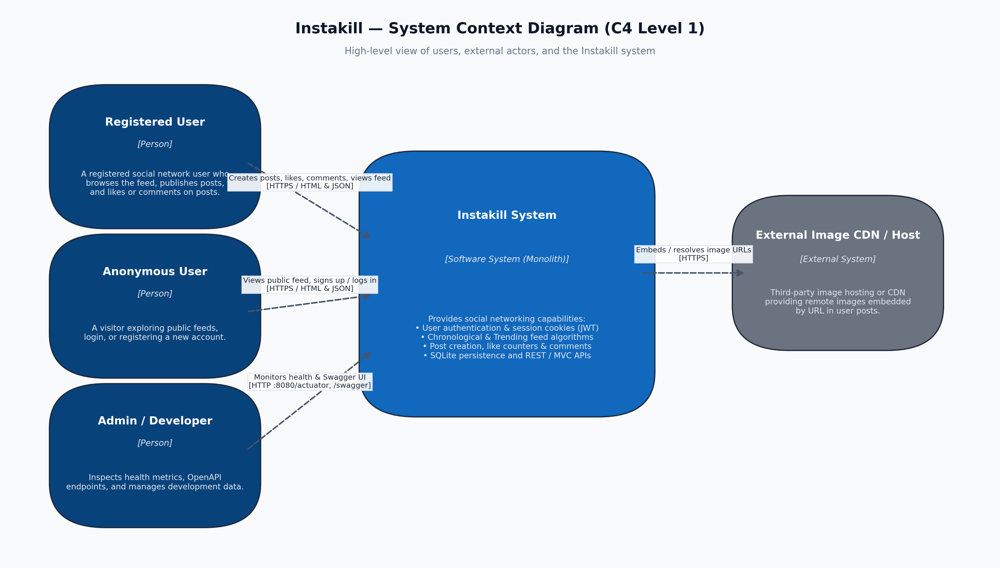
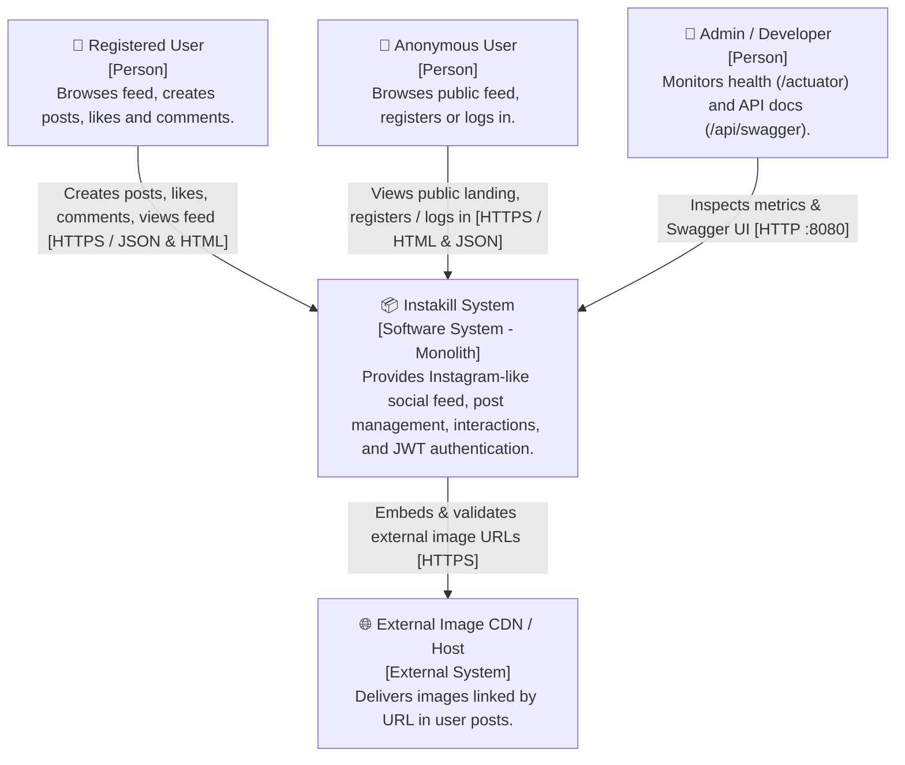
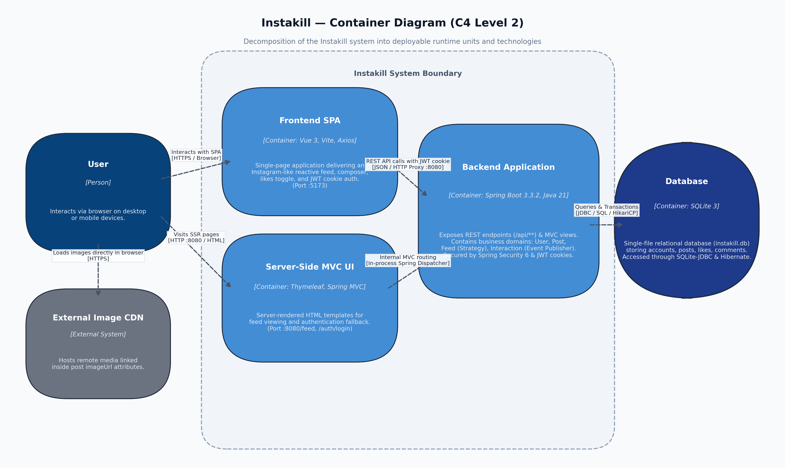
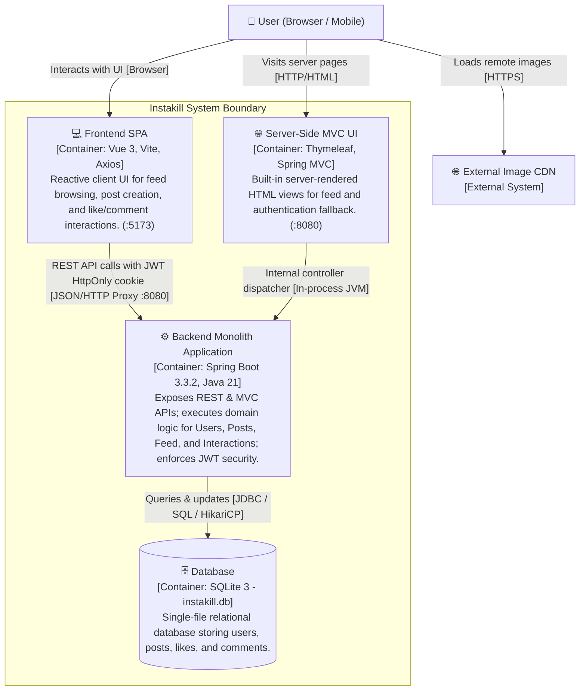
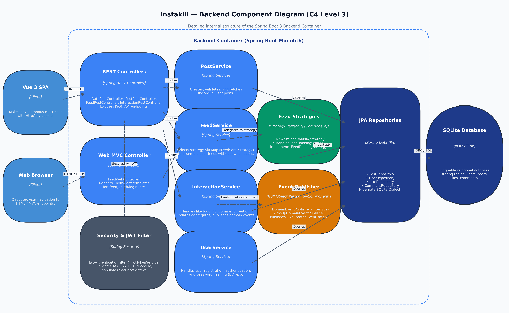
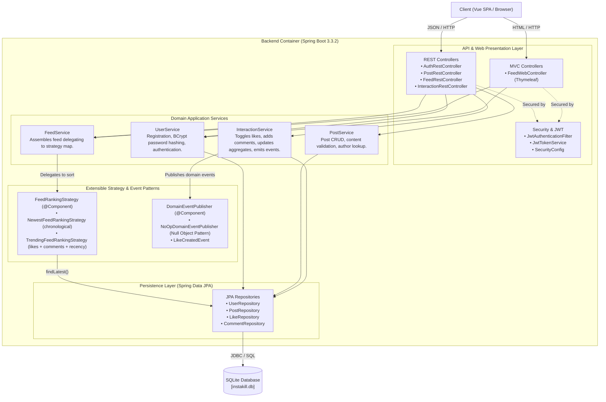

# Assignment 2: Software Architecture Fundamentals — Instakill

**Course**: Software Architecture  
**System**: Instakill (Spring Boot 3 / Vue 3 Monolith)  
**Deliverables**:
- **C4 Architecture Diagrams**: 
  - Context Diagram: [`docs/architecture/c4_context.png`](docs/architecture/c4_context.png) ([PDF](docs/architecture/c4_context.pdf))
  - Container Diagram: [`docs/architecture/c4_container.png`](docs/architecture/c4_container.png) ([PDF](docs/architecture/c4_container.pdf))
  - Component Diagram: [`docs/architecture/c4_component.png`](docs/architecture/c4_component.png) ([PDF](docs/architecture/c4_component.pdf))
  - All-in-One Multi-Page Document: [`docs/architecture/Instakill_C4_Architecture_Diagrams.pdf`](docs/architecture/Instakill_C4_Architecture_Diagrams.pdf)
- **Quality Attribute Assessment Document**: See [Task 2](#task-2--quality-attribute-assessment) below.

---

## Task 1 – C4 Model Diagrams

### 1.1 Level 1: System Context Diagram

The System Context diagram illustrates Instakill's boundaries, its primary user personas, and its relationship with external systems.

#### Mermaid Equivalent

#### Key Elements & Interactions
* **Registered User**: Authenticates via JWT cookie (`ACCESS_TOKEN`), publishes content with optional image URLs, browses the feed (sorted chronologically or by popularity), and interacts via likes/comments.
* **Anonymous User**: Accesses public feeds and registration/login endpoints.
* **Admin / Developer**: Uses Spring Boot Actuator (`/actuator/health`, `/actuator/info`) for liveness/readiness probes and Swagger OpenAPI UI (`/api/swagger`) for contract exploration.
* **External Image CDN / Host**: Hosts user-referenced media URLs delivered directly to client browsers.

---

### 1.2 Level 2: Container Diagram

The Container diagram breaks the Instakill system into its deployable and runnable units, showing runtime technologies and communication protocols.

#### Mermaid Equivalent

#### Key Containers & Technologies
1. **Frontend SPA (`frontend/`)**: Vue 3 with Vite and Axios. Consumes the REST API asynchronously, storing the JWT session in an `HttpOnly` cookie for automatic transmission on stateful requests.
2. **Server-Side MVC UI (`FeedWebController`)**: Spring Boot WebMVC with Thymeleaf templates. Provides a zero-dependency server-rendered web UI on port 8080.
3. **Backend Monolith (`backend/`)**: Spring Boot 3.3.2 on Java 21 LTS. Handles request routing, Spring Security 6 authentication, domain business logic, and transactional boundaries.
4. **Database (`instakill.db`)**: Local embedded SQLite 3 database mapped through Spring Data JPA, Hibernate Community SQLite Dialect 6.6, and HikariCP connection pooling.

---

### 1.3 Level 3: Component Diagram (Backend Container)

The Component diagram reveals the internal modular organization of the Spring Boot backend container.

#### Mermaid Equivalent

#### Key Components & Responsibilities
* **Security & Filter Chain**: Intercepts requests, validates the `ACCESS_TOKEN` JWT cookie, and populates the `SecurityContext`.
* **Feed Subsystem (Strategy Pattern)**: [`FeedService`](backend/src/main/java/com/instakill/feed/application/FeedService.java) accepts a `List<FeedRankingStrategy>`, builds a dispatch map (`Map<FeedSort, FeedRankingStrategy>`), and delegates ranking to [`NewestFeedRankingStrategy`](backend/src/main/java/com/instakill/feed/application/NewestFeedRankingStrategy.java) or [`TrendingFeedRankingStrategy`](backend/src/main/java/com/instakill/feed/application/TrendingFeedRankingStrategy.java).
* **Interaction Subsystem (Pluggable Event Publisher)**: [`InteractionService`](backend/src/main/java/com/instakill/interaction/application/InteractionService.java) maintains denormalized like and comment counts directly on `Post` entities, while delegating side-effect notifications to [`DomainEventPublisher`](backend/src/main/java/com/instakill/interaction/domain/DomainEventPublisher.java) (backed by default by [`NoOpDomainEventPublisher`](backend/src/main/java/com/instakill/interaction/application/NoOpDomainEventPublisher.java)).
* **Persistence**: Spring Data JPA repositories communicating through SQLite JDBC dialect.

---

## Task 2 – Quality Attribute Assessment

The following evaluation analyzes the monolithic architecture of Instakill across the six standard ISO/IEC 25010 software quality attributes:

| Quality Attribute | Meaning (Short) | Rating (1–10) | Justification (Architecture-Related Explanation) |
|:---|:---|:---:|:---|
| **Performance** | How quickly the system responds and processes data. | **6 / 10** | Embedded SQLite provides microsecond read latency for local queries without network round-trips. However, SQLite locks the entire database file during writes, and the trending feed algorithm sorts candidate posts in JVM memory on each request without query caching or database indexes, causing latency spikes under concurrent usage. |
| **Scalability** | How easily the system handles growth in users or data. | **3 / 10** | The system is architecturally constrained to a single server instance because SQLite is an embedded single-file storage engine that cannot be accessed concurrently across distributed compute nodes. Scaling horizontally is impossible without replacing SQLite with a networked database (e.g., PostgreSQL) and externalizing state. |
| **Reliability** | How resilient the system is to faults and failures. | **5 / 10** | Running as a single monolithic process creates a single point of failure (SPOF) where an uncaught exception, JVM crash, or disk I/O lock halts all services (auth, feed, posts). However, transactional ACID compliance within SQLite and automated JPA transaction rollbacks preserve data integrity during unexpected errors. |
| **Maintainability** | How simple it is to modify, extend, or debug. | **8 / 10** | The codebase follows clean domain-driven package organization (`user`, `post`, `feed`, `interaction`) with decoupled business layers and automated unit tests. Adopting design patterns (Strategy pattern for feed ranking, Null Object pattern for event publishing) allows extending core behaviors without modifying existing services. |
| **Security** | How well the system protects data and access. | **6 / 10** | The system enforces industry-standard BCrypt password hashing, Spring Security filter chains, and JWT storage in `HttpOnly` cookies to protect against cross-site scripting (XSS) token exfiltration. However, the JWT signing key is currently hardcoded in application configuration, and the system lacks rate-limiting, brute-force protection, and role-based authorization (RBAC). |
| **Usability** | How intuitive and effective it is for end users. | **7 / 10** | The application offers dual client accessibility: a lightweight Thymeleaf server-rendered web UI for immediate use, and a modern Vue 3 SPA with reactive feed updates. However, usability is hindered by the lack of optimistic UI updates, absent progress feedback for network operations, and manual page reloads required to view new posts. |

---

## Discussion: Trade-offs and Architectural Gaps

### 1. Strengths of the Current Design
* **Zero Operational Friction**: SQLite requires no external database server, connection setup, or cloud provisioning, making the project instantly testable and runnable on local developer machines.
* **Low Latency & High In-Memory Cohesion**: In-process method calls between modules (`FeedService` -> `PostRepository`) eliminate inter-service network serialization and latency overhead.
* **Extensibility via Design Patterns**: The Strategy and Null Object patterns introduced in Assignment 1 decouple business policies, allowing developers to plug in new algorithms or event subscribers without touching core classes.

### 2. Architectural Bottlenecks & Gaps
* **Database Concurrency Bottleneck**: SQLite's table-level and file-level locking mechanism serializes all write operations (likes, comments, posts), causing database lock timeout exceptions (`SQLITE_BUSY`) when multiple active users interact simultaneously.
* **Compute & Storage Tight Coupling**: Application business logic and database persistence reside on the same disk and OS process; hardware capacity cannot be scaled independently for compute-heavy tasks (feed ranking) versus I/O-heavy tasks (image rendering/storage).
* **Missing Media Pipeline**: The application only stores external image URLs as strings. In a production social network, missing media upload pipelines (object storage like AWS S3 / MinIO, asynchronous thumbnail compression, CDN caching) represent a significant architectural gap.

### 3. Recommended Evolution Roadmap
1. **Database Migration**: Migrate from embedded SQLite to a networked relational database (PostgreSQL) with connection pooling and read replicas.
2. **Caching Layer**: Introduce Redis for caching high-traffic feeds (`trending`, `new`) and session blacklist invalidation.
3. **Asynchronous Event Broker**: Implement `DomainEventPublisher` using Apache Kafka or RabbitMQ to stream `LikeCreatedEvent` and `CommentCreatedEvent` for async analytics and notification processing.
4. **Service Extraction**: Split into independent microservices (`Auth/User Service`, `Feed Service`, `Post Service`, `Interaction Service`) orchestrated behind a lightweight API Gateway (e.g. Spring Cloud Gateway).

